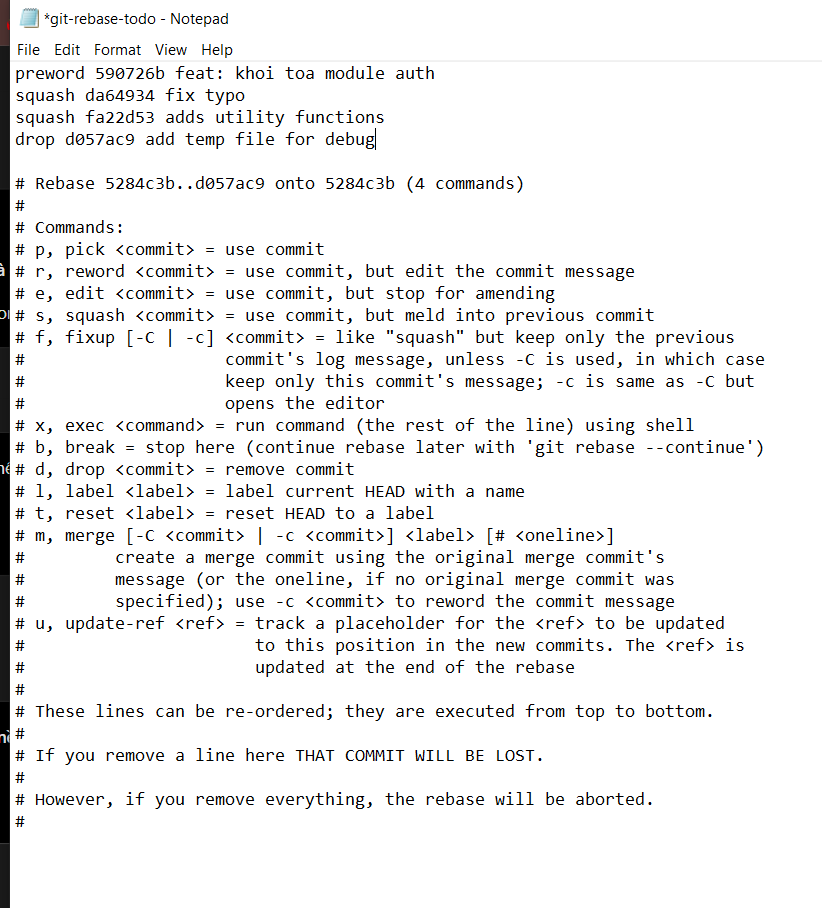
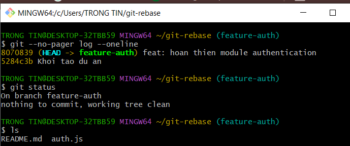

# Bài 2: Tái cấu trúc lịch sử commit bằng Interactive Rebase

## 1. Chuẩn bị

Tạo repository git-rebase và cấu hình danh tính cục bộ:
- Tên: Pham Ngoc Linh
- Email: phamngoclinhtq2006@gmail.com

Tạo commit nền 5284c3b với thông điệp "Khoi tao du an"
và thực hành trên nhánh feature-auth.

## 2. Lịch sử trước khi rebase

```text
d057ac9 add temp file for debug
fa22d53 adds utility functions
da64934 fix typo
590726b feat: khoi toa module auth
5284c3b Khoi tao du an
```

Ba commit phát triển auth.js cần được gộp.
Commit tạo temp.txt cần được loại bỏ.

## 3. Thực hiện Interactive Rebase

Chạy:

```bash
git rebase -i HEAD~4
```

Cấu hình trong trình soạn thảo:

```text
reword 590726b feat: khoi toa module auth
squash da64934 fix typo
squash fa22d53 adds utility functions
drop d057ac9 add temp file for debug
```

- reword: đổi thông điệp commit đầu tiên.
- squash: gộp hai commit tiếp theo vào commit đầu tiên.
- drop: loại bỏ commit chứa temp.txt.

Lưu cấu hình và đặt thông điệp commit gộp thành:
feat: hoan thien module authentication

Trong quá trình thực hiện, đã sửa lỗi gõ "preword" thành "reword"
bằng git rebase --edit-todo, rồi chạy git rebase --continue.
Sau khi bị ngắt bằng Ctrl + C, tiếp tục bằng git rebase --continue
để hoàn tất bước drop cuối cùng.


## 4. Kiểm tra sau khi hoàn tất

```bash
git --no-pager log --oneline
git status
ls
```

Dán kết quả thực tế sau khi rebase hoàn tất tại đây.

Kết quả yêu cầu:
- Còn một commit tính năng với thông điệp:
  feat: hoan thien module authentication
- Giữ lại commit nền 5284c3b.
- Nội dung auth.js được giữ đầy đủ.
- Không còn temp.txt.
- Nhánh feature-auth có trạng thái working tree clean,
  không còn rebase đang diễn ra.





## 5. Giải thích

Interactive Rebase cho phép chỉnh sửa lịch sử commit cục bộ.
Sau khi gộp, các thay đổi của ba commit tính năng nằm trong
một commit mới. Commit tạo tệp rác bị loại khỏi lịch sử nhánh.